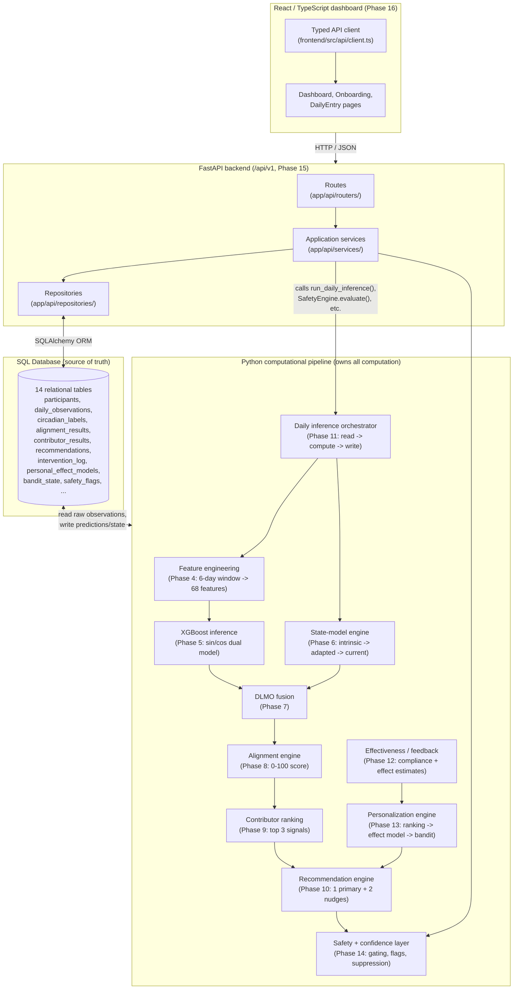
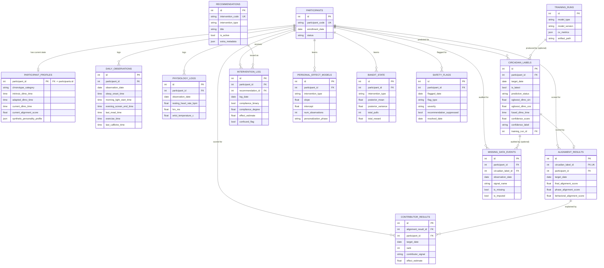
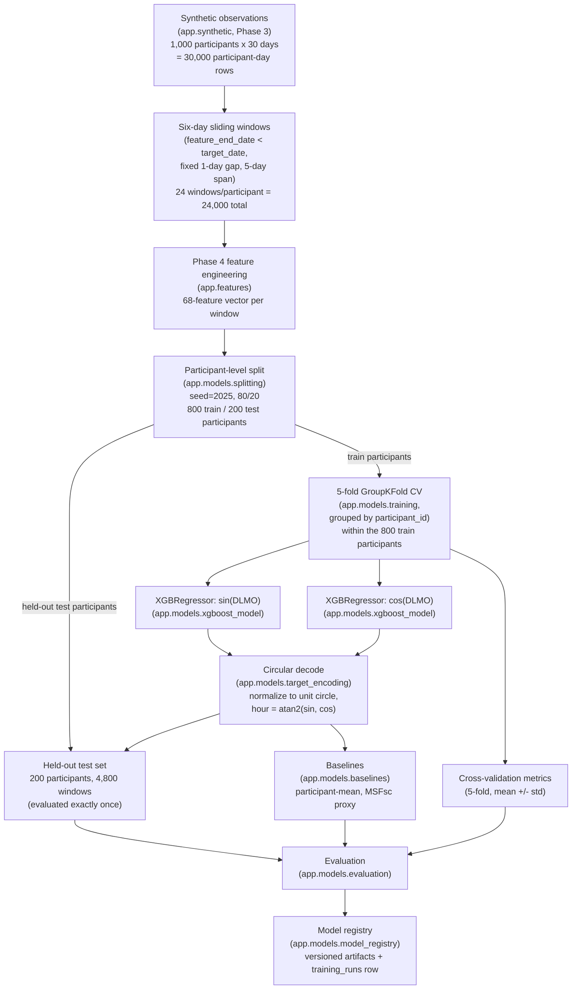
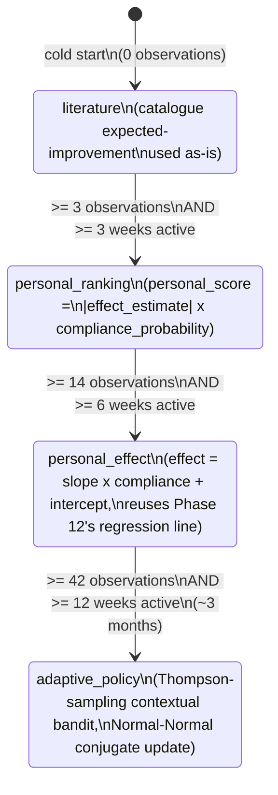
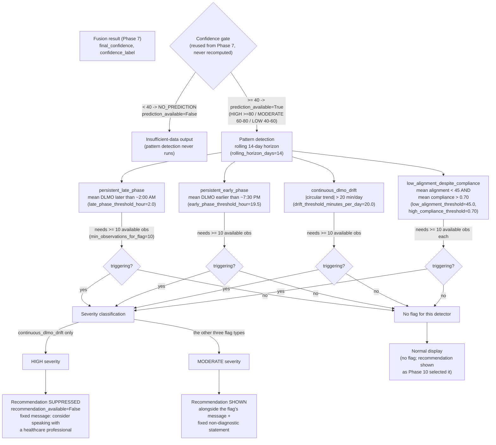

# CircadianIQ Architecture Diagrams (Phase 18)

This file is part of **Phase 18 release documentation** (packaging,
freeze, and documentation). It collects the system's key structural
and behavioral diagrams in one place, all rendered as **Mermaid**
diagrams rather than static images, per the Phase 18 spec's explicit
preference for diagrams that are editable and regenerable directly
from source (a checked-in text description that renders natively on
GitHub and most markdown viewers) rather than a binary export that
goes stale the moment the source changes. Several of these diagrams
adapt or expand Mermaid diagrams that already exist in the phase-level
docs (`docs/database_architecture.md`, `docs/daily_inference_pipeline.md`);
they are reproduced and extended here so a reader can see the whole
system's structure in one file.

**Standard project disclaimer**, repeated here because every diagram
below touches it in some way: this is release **v1.0.0-research-demo**,
Phase 17 audit status **CONDITIONAL PASS**, running entirely on
**synthetic data**. CircadianIQ computationally *estimates* circadian
phase from behavioral and environmental proxies; it does not measure
laboratory DLMO, has not been validated against real human data, and
must never be presented, read, or reused as a clinical or diagnostic
tool.

---

## 1. Complete system architecture

This diagram renders the same SQL &harr; Python pipeline &harr; API &harr;
UI structure described in `README.md`'s "Architecture" section, with
added structural detail: the individual computational modules inside
the Python pipeline (naming each phase from the repository layout),
the FastAPI layer's own internal structure (routes &rarr; services &rarr;
domain modules &rarr; repositories), and the React/TypeScript frontend
that consumes it. It does not introduce any component the README does
not already describe -- it is the same hybrid SQL + Python system, with
the Python "computational pipeline" box expanded into its constituent
phases and the API/UI layers (added in Phases 15-16, after the README's
original architecture section was written) shown explicitly.



**Notes.** The SQL database is the authoritative source of truth for
history, current state, and learned personalization/safety state;
Python owns 100% of the computation (nothing is computed in SQL). The
API layer contains **no** biological, ML, recommendation, or safety
logic of its own -- every route delegates to an existing Phase 4-14
module and only orchestrates/formats. The frontend similarly contains
**no** domain logic -- every number and label it shows is either
returned verbatim by the API or looked up from a small fixed
terminology table. `POST /participants/{id}/inference` is the only
endpoint that triggers computation; every other endpoint is a
read-only database query.

---

## 2. Database ER diagram

The 14 tables and their relationships, adapted and expanded from the
existing entity-relationship diagram in `docs/database_architecture.md`
&sect;1, cross-checked against that file's table-by-table column
reference (&sect;3). Cardinalities and foreign keys shown here match
that document exactly; nothing here is invented.



**Notes.** `alignment_results` and `contributor_results` carry a
deliberately **denormalized** `participant_id`/`target_date` (strictly
derivable via a join through `circadian_labels`) so the common query
"give me this participant's history" never needs an extra join --
documented as a query-convenience denormalization, not duplicated
participant identity data. `circadian_labels` follows a one-row-per-
prediction-event pattern (not one-row-per-date): reruns insert a new
row and flip the prior row's `is_latest` to `False` rather than
overwriting history. `physiology_logs` is kept structurally separate
from `daily_observations` on purpose, so Version-1 code cannot
"accidentally" use physiological signals as behavioral inputs.

---

## 3. Daily inference sequence diagram

This sequence diagram is adapted from `docs/daily_inference_pipeline.md`
&sect;1, with the idempotency short-circuit and the atomic-transaction
commit/rollback made explicit as their own steps (both are documented
in that file's &sect;11-12). The entry point is
`app.pipeline.orchestrator.run_daily_inference(participant_id,
target_date, session_factory, config, models_dir, force_rerun)`; the
orchestrator is pure glue -- it calls each phase's own existing public
entry point and never reimplements a formula.

```mermaid
sequenceDiagram
    participant Caller
    participant Pipeline as run_daily_inference
    participant DB
    participant Features as Phase 4 (features)
    participant XGB as Phase 5 (XGBoost)
    participant State as Phase 6 (state engine)
    participant Fusion as Phase 7 (fusion)
    participant Align as Phase 8 (alignment)
    participant Contrib as Phase 9 (contributors)
    participant Reco as Phase 10 (recommendation)

    Caller->>Pipeline: run_daily_inference(pid, target_date, force_rerun=False)
    Pipeline->>DB: existing is_latest CircadianLabel for this pipeline?
    alt already computed (idempotent short-circuit)
        DB-->>Pipeline: existing CircadianLabel
        Pipeline-->>Caller: ALREADY_COMPUTED (persistence_status="skipped", no recomputation)
    else compute fresh
        Pipeline->>DB: read participant, 6-day window (N-6..N-1), previous label
        Pipeline->>State: step(previous_state, day N-1's behavior)
        opt >= 6 consecutive prior days available
            Pipeline->>Features: build_features(pid, target_date) -> 68-feature vector
            Pipeline->>XGB: predict_hours(X) -> xgb_dlmo (sin/cos decoded)
        end
        Pipeline->>Fusion: fuse(xgb_dlmo, state_dlmo, previous_fused, data_quality)
        opt fused_final is not None
            Pipeline->>Align: compute_alignment(fused_dlmo, day N-1 behavior)
            Pipeline->>Contrib: rank_contributors(...)
            Pipeline->>Reco: select_recommendations(...) [personalization_phase="literature"]
        end
        Pipeline->>DB: BEGIN transaction (session_scope)
        Pipeline->>DB: supersede prior is_latest row (is_latest=False)
        Pipeline->>DB: insert CircadianLabel + AlignmentResult + ContributorResult rows
        Pipeline->>DB: supersede/insert InterventionLog (primary recommendation only)
        Pipeline->>DB: update ParticipantProfile current/adapted DLMO + alignment
        alt any step in the write phase raises
            Pipeline->>DB: ROLLBACK (all-or-nothing; zero partial writes)
            Pipeline-->>Caller: FAILED (stage="persistence")
        else all writes succeed
            Pipeline->>DB: COMMIT
            Pipeline-->>Caller: DailyInferenceResult (SUCCESS / INSUFFICIENT_HISTORY / NO_PREDICTION)
        end
    end
```

**Notes.** Start-of-day timing is locked: inference for Day N runs at
the *start* of Day N using only Days N-6..N-1 -- Day N's own behavior
is never used to predict Day N. With fewer than 6 consecutive prior
days, the result is `INSUFFICIENT_HISTORY` (not a failure) and
state-only fusion still runs and persists. The entire write phase is
one atomic transaction (`app.database.engine.session_scope`); a forced
failure during any step rolls back the whole block, leaving zero
pipeline-authored rows and an untouched `ParticipantProfile`
(`test_write_failure_rolls_back_entire_transaction`).

---

## 4. ML pipeline diagram

The offline training pipeline (Phase 5), from Phase 3's synthetic
observations through evaluation. Sourced from
`docs/synthetic_data_generation.md` and
`docs/model_training_and_validation.md`, with the real module names
from that file's module map (`app/models/`).



**Notes.** The circular DLMO target is solved as **two independent**
`XGBRegressor` models (`sin(DLMO)`, `cos(DLMO)`) rather than one
multi-output model -- a deliberate choice for unambiguous per-target
feature importance/SHAP analysis, documented in
`docs/model_training_and_validation.md` &sect;6. Splitting is always
**participant-level**, never row-level, so no participant's windows
ever appear on both sides of a split or a fold. The held-out test set
(200 participants, 4,800 windows) is read exactly once, after final
training on all 800 training participants -- never during CV or
hyperparameter selection. Hyperparameters (`n_estimators=500,
max_depth=6, learning_rate=0.05, ...`) are the project brief's own
documented "engineering starting points," not the result of a
hyperparameter search. Held-out result: **MAE 24.47 min, RMSE 31.86
min, 93.73% within &plusmn;60 min** -- reached on synthetic data only;
this performance does not demonstrate equivalent performance on real
human DLMO data.

---

## 5. Recommendation / feedback loop

How a selected recommendation eventually feeds back into the next
recommendation call, sourced from `docs/recommendation_engine.md`
(Phase 10) and `docs/intervention_effectiveness.md` (Phase 12), with
the personalization consumption point from `docs/personalization_engine.md`
(Phase 13).

```mermaid
flowchart LR
    A["Recommendation selected\n(app.recommendations.engine\n.select_recommendations)\n1 primary + up to 2 supporting nudges"]
    B["Logged to intervention_log\n(Phase 11 write phase)\ntarget values, expected improvement,\npersonalization_phase at time of issue"]
    C["Compliance backfilled\n(app.effectiveness.backfill\n.backfill_compliance)\nonce day N's own observation exists"]
    D["Effectiveness evaluated\n(app.effectiveness.dispatcher\n.evaluate_intervention_effect)"]
    D1["Phase 1: observational\n(baseline vs. recent 7-day window)"]
    D2["Phase 2: matched_observational\n(within-person matched prior period)"]
    D3["Phase 3: regression_controlled_estimate\n(OLS on compliance + covariates,\n>= 21 complete rows)"]
    E["Stored in\nintervention_effect_estimates\n(immutable, one row per evaluation)"]
    F["Personalization state updated\n(app.personalization.update\n.update_personalization_state)\nranking score / effect model / bandit posterior"]
    G["Next recommendation call\n(personalization_phase reflects\nupdated evidence)"]

    A --> B --> C --> D
    D --> D1 --> E
    D1 -.->|"if sufficient"| D2 --> E
    D2 -.->|"if sufficient"| D3 --> E
    E --> F --> G
    G -.->|"loop"| A
```



**Notes.** Phase 12 always evaluates Phase 1 first; if insufficient it
stops there -- Phase 2/3 are only attempted if their own, independent
sufficiency gates clear, and the **highest** phase that actually
cleared its gate is reported (never Phase 3 just because Phase 2
succeeded). A recomputation always **inserts a new**
`intervention_effect_estimates` row; old estimates are never
overwritten, so the full history of how an estimate evolved stays
auditable. Phase 12's Phases 1-2 are **observational** (association,
not causation) even when a change lines up with an intervention;
Phase 3 controls for a handful of measured covariates in one
participant's own data and cannot rule out unmeasured confounds. All
decay constants, window lengths, and thresholds throughout this loop
are documented **project design choices**, not clinically validated
parameters.

---

## 6. Personalization phase progression

The four personalization phases and their real evidence-gate
thresholds, taken directly from `app.personalization.config` and
cross-checked against `docs/personalization_engine.md` &sect;2-6. A
participant progresses independently **per** `(participant_id,
intervention_type)` pair -- there is no single global phase for a
participant; e.g. a participant can simultaneously be
`personal_effect` for morning light and `literature` for caffeine.



**Notes.** All threshold values above
(`ranking_min_observations=3`/`ranking_min_weeks_active=3`,
`effect_model_min_observations=14`/`effect_model_min_weeks_active=6`,
`adaptive_min_observations=42`/`adaptive_min_weeks_active=12`) are
**project engineering graduation rules**, not statistical or clinical
requirements. A separate, orthogonal mechanism blends personal and
literature evidence within `personal_ranking`/`personal_effect`: below
21 valid personal observations the effective estimate is `0.40 *
personal + 0.60 * literature`; at or above 21 it is 100% personal;
and if the personal model fails its own validity checks, the system
falls back to 100% literature regardless of observation count
(`app.personalization.blending.blend_effect`,
`docs/personalization_engine.md` &sect;7). Every read in this system
filters strictly by `as_of_date` (`log_date < as_of_date`), so a
recommendation being personalized for day N can never see evidence
from day N or later.

---

## 7. Safety decision tree

The Phase 14 safety and confidence layer's decision flow, sourced
directly from `app/safety/engine.py` (`SafetyEngine.evaluate`) and
`app/safety/patterns.py` (the four detectors), with the exact
threshold values taken from `app.safety.config.SafetyConfig`.



**Notes.** Every detector operates only on days with
`prediction_available=True`; a day with no prediction is excluded from
evidence entirely (never treated as neutral or fabricated). All four
flag thresholds and the 10/14/7-observation parameters are **project
screening parameters**, chosen for this system's own escalation logic
-- not sourced from, or claimed equivalent to, any validated clinical
diagnostic criterion; this layer is explicitly **screening, not
diagnosis**, and its messages never name a specific medical condition.
Flag resolution requires `resolution_min_normal_observations=7`
consecutive available non-triggering observations before an open flag
is closed -- a single normal day never resolves it. Confidence gating
and pattern detection are deliberately independent axes: a participant
can have high confidence with an active safety flag, or low confidence
with none.
