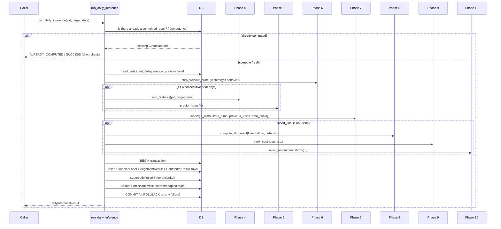

# CircadianIQ Daily Inference Pipeline (Phase 11)

## 1. Complete pipeline flow

```
DATABASE (read)
    -> FEATURE ENGINE (Phase 4)
    -> XGBOOST (Phase 5)  +  STATE ENGINE (Phase 6)
    -> DLMO FUSION (Phase 7)
    -> ALIGNMENT (Phase 8)
    -> CONTRIBUTORS (Phase 9)
    -> RECOMMENDATION (Phase 10)
    -> DATABASE (one atomic write)
```

Entry point: `app.pipeline.orchestrator.run_daily_inference(participant_id, target_date, session_factory, config, models_dir, force_rerun)`.
This phase is **pure orchestration** -- it calls each phase's existing
public entry point (`build_features`, `DualComponentXGBModel.predict_hours`,
`app.state.engine.step`, `app.fusion.fuse.fuse`, `compute_alignment`,
`rank_contributors`, `select_recommendations`) and never re-implements
any of their formulas.



## 2. Start-of-day timing (locked)

Inference for **Day N** runs at the *start* of Day N, using only Days
`N-6 .. N-1` -- Day N's own behavior is never used to predict Day N.
After Day N completes, its observation becomes part of the window for
Day N+1 (`Days N-5..N` -> predict Day N+1).

## 3. Six-day feature window

`app.pipeline.read.read_daily_inference_inputs` computes the
**unbroken run of `daily_observations` rows ending at `target_date - 1`**
(gaps truncate the run -- a six-day window with a hole in it is not a
valid window). Only when that run has >= 6 days does the pipeline call
`app.features.builder.build_features(participant_id, target_date, session)`
-- Phase 4's own single-participant/single-date entry point, which
computes its window bounds (`target_date - 6 .. target_date - 1`)
internally. The pipeline validates the returned `FeatureVector` has
exactly 68 named features matching the locked manifest and that
`window_end < target_date` (no target-day leakage), but performs no
feature computation itself.

## 4. Model inference (Phase 5)

`app.pipeline.xgboost_step.run_xgboost_step` loads a **specific,
configured** model version (`PipelineConfig.xgboost_model_version`,
default `1`) via `app.models.model_registry.load_model_artifacts` --
never "whichever file happens to exist." The 1-row feature `DataFrame`
is built with columns in the exact order `feature_vector.feature_names`
(the loaded model rejects any other order/membership). `predict_hours`
already applies the shared sin/cos circular decode
(`app.models.target_encoding.decode_predictions`); this module never
reimplements it. No training or fitting occurs here.

## 5. State inference (Phase 6)

`app.pipeline.state_step.run_state_step`:

- **No prior state exists** (true Day-0 onboarding): calls
  `app.state.engine.initialize_state(intrinsic_dlmo_hour, ...)`.
- **A prior state exists and yesterday's behavior is complete**: calls
  `app.state.engine.step(previous_state, behavior, traits, date=target_date)`
  -- one deterministic forward transition.
- **A prior state exists but yesterday's behavior is missing/incomplete**:
  the prior state is carried forward unchanged (never fabricated).

Never calls XGBoost. `ParticipantPhaseTraits.baseline_sleep_onset_hour`
and the three sensitivities are not real `participant_profiles`
columns (Phase 3 synthetic-generation concepts only); see
`app.pipeline.traits` for the documented fallback (mean of the
window's own observed sleep onset; sensitivities default to `1.0`)
used whenever a participant's `synthetic_personality_profile` blob
does not supply them.

## 6. Fusion (Phase 7)

`app.pipeline.quality.build_data_quality_input` decides the
`DataQualityTier` from `FeatureVector.completeness` (thresholds
`0.95/0.80/0.50`, the same convention `app.scripts.run_fusion_diagnostics`
already used) -- the only piece of "gluework" this phase contributes;
`app.fusion.fuse.fuse` itself is called unmodified with `xgb_dlmo`,
`state_dlmo`, the previous day's fused value (read from
`CircadianLabel.fused_dlmo_time`), and the data-quality input. All
four fusion layers (base weights, disagreement, continuity cap,
confidence penalty) remain exclusively Phase 7's.

## 7. Alignment (Phase 8)

Only runs if `fusion_result.fused_final is not None`. Uses
`app.alignment.db_adapter.build_alignment_inputs(fused_dlmo, window_observations, ...)`
-- the most recently completed sleep period is Day N-1's, consistent
with start-of-day timing; Day N's own (not-yet-existing) sleep is
never referenced.

## 8. Contributor ranking (Phase 9)

`app.contributors.db_adapter.build_contributor_inputs(traits, alignment_result, window_observations, ...)`
followed by `rank_contributors(...)` -- no ranking logic is
reimplemented.

## 9. Recommendation (Phase 10)

Candidate interventions come from `app.recommendations.db_adapter.load_candidate_interventions`
(the live `recommendations` table). Recent compliance history and any
prior primary intervention are also read from the database
(`load_recent_compliance`, `load_prior_primary`). The personalization
system is not yet operational in this phase, so
`RecommendationInputs.personalization_phase` defaults to `"literature"`
-- the recommendation engine's own documented default pathway; no
special-casing is added here for that.

## 10. State update

After a fused value is computed:

- `ParticipantProfile.current_dlmo_time` / `current_dlmo_date` <-
  `fusion_result.fused_final`, `target_date`.
- `ParticipantProfile.adapted_dlmo_time` <- the state engine's own
  `new_state.adapted_dlmo_hour` (whether just stepped forward or
  carried forward unchanged).
- `ParticipantProfile.current_alignment_score` / `current_alignment_date`
  <- `alignment_result.final_score`, `target_date` (if alignment ran).
- `chronotype_category` and `intrinsic_dlmo_time` are **never** written
  by this pipeline.

## 11. Atomic persistence

Everything in `app.pipeline.persistence` operates on an already-open
`Session` and performs zero computation -- by the time any of it runs,
every upstream result already exists in memory. The orchestrator wraps
the entire write phase in one `app.database.engine.session_scope(...)`
block: `supersede_existing_label` -> insert `CircadianLabel` -> insert
`AlignmentResult` + `ContributorResult` rows -> supersede/insert
`InterventionLog` -> update `ParticipantProfile`, all inside one
transaction. Any exception anywhere in that block rolls back **all**
of it -- verified by `test_write_failure_rolls_back_entire_transaction`
(a forced failure during recommendation persistence leaves zero
pipeline-authored `CircadianLabel` rows and an untouched
`ParticipantProfile`).

## 12. Idempotency

Before any computation, the pipeline checks for an existing
`is_latest` `CircadianLabel` whose `prediction_status` was written by
*this* pipeline (`success` / `insufficient_history` / `no_prediction`
-- not a Phase 3 synthetic `synthetic_ground_truth` seed row, which is
reference data, not a prior run). If found and `force_rerun=False`
(the default), the existing row is returned immediately
(`idempotent_short_circuit=True`, `persistence_status="skipped"`) with
no recomputation and no new row. `force_rerun=True` bypasses the
short-circuit for an explicit versioned rerun.

## 13. Retry behavior

Since the write phase is one all-or-nothing transaction, a failed
attempt leaves the database exactly as it was before the attempt
(section 11) -- a subsequent call (with or without `force_rerun`,
since a failed attempt writes nothing for the idempotency check to
find) safely recomputes and writes exactly once. Verified by
`test_retry_after_failure_succeeds_without_duplicate`.

## 14. Failure handling (policy)

| Failure point | Policy |
|---|---|
| Feature engine raises | `FAILED` at stage `"feature_engine"`; nothing written. |
| XGBoost raises (features were fine) | Caught and logged; treated as "XGBoost unavailable this run" -- fusion's own documented state-only fallback chain (`previous_fused -> state -> xgb -> None`) applies. |
| State engine has nothing to step with | Prior state carried forward unchanged (not a failure). |
| Alignment/contributor/recommendation raises | `FAILED` at stage `"alignment_contributor_recommendation"`; a fused DLMO is never paired with a silently-invented alignment score. |
| Persistence (any write) raises | Transaction rolls back in full; `FAILED` at stage `"persistence"`, `persistence_status="not_attempted"`. |
| Fewer than 6 consecutive prior days | `INSUFFICIENT_HISTORY` (not a failure) -- state-only fusion still runs and is still persisted. |
| >= 6 days but fusion suppresses prediction (data quality) | `NO_PREDICTION` (not a failure). |

## 15. Version/provenance tracking

Every result carries a `diagnostics["provenance"]` dict: `pipeline_version`,
`feature_manifest_version`, `model_version`, `state_config_version`,
`fusion_config_version`, `alignment_config_version`,
`contributor_config_version`, `recommendation_config_version`. What
the current Phase 2 schema itself supports is persisted directly:
`CircadianLabel.training_run_id` links to a `training_runs` row
(get-or-create, keyed by model type + version) giving a queryable FK
to the exact model version used; `AlignmentResult.component_snapshot`
additionally carries the full `provenance` dict alongside the
behavioral-component breakdown, since that JSON column is the nearest
existing, already-generic "auxiliary snapshot" field in the schema.
No new table was introduced for this ("where supported by the
schema" -- see Limitations).

## 16. Historical vs. current state

- **Historical** (immutable, one row per prediction event):
  `CircadianLabel`, `AlignmentResult`, `ContributorResult`,
  `InterventionLog`. A rerun never overwrites a prior row -- it flips
  the old row's `is_latest` to `False` and inserts a new one.
- **Current** (the one mutable pointer per participant):
  `ParticipantProfile.current_dlmo_time` / `adapted_dlmo_time` /
  `current_alignment_score`. These are conveniences for "what does
  this participant look like right now", never a substitute for
  reading the historical rows when provenance matters.

## 17. Example Day 10 execution

At the start of Day 10, `daily_observations` has complete rows for
Days 4-9 (6 consecutive days). `run_daily_inference(pid, day_10, ...)`:

1. Reads Days 4-9 (`history_days_available=6`), and the Day 9
   `CircadianLabel` for `previous_fused_dlmo`.
2. Steps the state engine forward using Day 9's completed behavior.
3. `history_days_available >= 6` -> builds Phase 4 features over Days
   4-9, runs XGBoost -> `xgb_dlmo`.
4. Fuses `xgb_dlmo` + `state_dlmo` + Day 9's fused value ->
   `fused_final`.
5. Computes alignment against Day 9's actual sleep onset, ranks
   contributors, selects a recommendation.
6. Commits one transaction: new `CircadianLabel`/`AlignmentResult`/
   `ContributorResult`/`InterventionLog` rows for Day 10, and updates
   `ParticipantProfile` current/adapted state.
7. After Day 10 completes, its own observation joins the window
   (Days 5-10) for Day 11's inference.

## Limitations

- `baseline_sleep_onset_hour` and the three behavioral sensitivities
  are Phase 3 synthetic-generation concepts with no real
  `participant_profiles` columns; the documented fallback (section 5)
  is a production approximation, not a recovered ground-truth trait.
- Only the **primary** recommendation is persisted to
  `intervention_log` (one row per participant/date); supporting
  nudges are present in the returned `RecommendationResult` but the
  current schema has no per-day slot for logging more than one
  intervention.
- No dedicated pipeline-provenance table was added; provenance not
  representable in the existing schema is only available in the
  returned `DailyInferenceResult.diagnostics`, not queryable from the
  database directly (see section 15).
- Personalization is not yet operational (Phase 12+); every run uses
  the `"literature"` pathway.
- This phase does not measure whether a prediction was *correct* --
  that requires ground truth this pipeline does not have access to.
