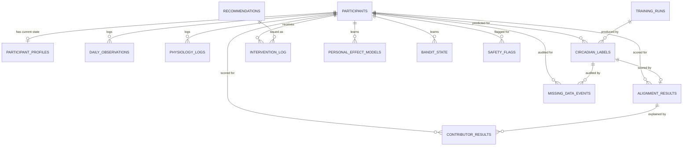

# CircadianIQ Database Architecture (Phase 2)

This document describes the complete relational schema for CircadianIQ.
It is the authoritative reference for the tables, columns, keys,
constraints, and indexes implemented as SQLAlchemy ORM models under
[`app/database/models/`](../app/database/models/) and versioned as
Alembic migrations under [`migrations/`](../migrations/).

Scope reminder: this phase defines **storage only**. No ML training,
feature engineering, DLMO equations, alignment weighting, contributor
ranking, recommendation selection, personalization algorithms, or
safety-detection logic is implemented here -- those are later phases.
Where a field will eventually hold a scientifically derived value
(an effect size, a threshold, a literature-cited improvement), the
column exists but is left `NULL` until a later phase populates it.

---

## 1. Conceptual ER diagram



Text summary of the same relationships:

```
participants (1) --- (1) participant_profiles
participants (1) --- (N) daily_observations
participants (1) --- (N) physiology_logs
participants (1) --- (N) circadian_labels
participants (1) --- (N) alignment_results          (denormalized FK, see §9)
participants (1) --- (N) contributor_results         (denormalized FK, see §9)
participants (1) --- (N) intervention_log
participants (1) --- (N) personal_effect_models
participants (1) --- (N) bandit_state
participants (1) --- (N) missing_data_events
participants (1) --- (N) safety_flags

circadian_labels (1) --- (1) alignment_results
alignment_results (1) --- (N) contributor_results
circadian_labels (1) --- (N) missing_data_events    (optional link to the run it informed)
training_runs (1) --- (N) circadian_labels          (optional model traceability)

recommendations (1) --- (N) intervention_log
```

---

## 2. Complete table list

| # | Table | Purpose |
|---|-------|---------|
| 1 | `participants` | Identity/onboarding metadata |
| 2 | `participant_profiles` | Stable biology + current computed state |
| 3 | `daily_observations` | Raw daily behavioral/environmental inputs |
| 4 | `physiology_logs` | Raw daily physiological measurements (not used by V1 ML) |
| 5 | `circadian_labels` | Immutable per-run circadian phase predictions |
| 6 | `alignment_results` | Alignment score + component breakdown per prediction |
| 7 | `contributor_results` | Ranked contributor signals per alignment result |
| 8 | `recommendations` | Candidate intervention catalogue |
| 9 | `intervention_log` | Append-only record of interventions issued and their outcomes |
| 10 | `personal_effect_models` | Learned per-participant intervention-effect model (current state) |
| 11 | `bandit_state` | Learned per-participant contextual-bandit posterior (current state) |
| 12 | `missing_data_events` | Missing-data / imputation audit trail |
| 13 | `safety_flags` | Safety flag events |
| 14 | `training_runs` | Model training run metadata |

---

## 3. Table-by-table reference

Type names below are the SQLAlchemy generic types used in the models
(see §12 for how each maps onto SQLite vs. PostgreSQL).

### 3.1 `participants`

Identity/onboarding only. Biological and computed state deliberately
live elsewhere (§3.2) so this table stays effectively append-only.

| Column | Type | Constraints |
|---|---|---|
| `id` | Integer | **PK** |
| `participant_code` | String(50) | **UNIQUE**, indexed, NOT NULL |
| `enrollment_date` | Date | NOT NULL |
| `status` | String(30) | NOT NULL, default `"active"` |
| `onboarding_completed_at` | Date | nullable |
| `created_at` | DateTime(tz) | NOT NULL, server default now |
| `updated_at` | DateTime(tz) | NOT NULL, server default now, on update now |

### 3.2 `participant_profiles`

One row per participant (1:1). Holds the three distinct DLMO concepts
and the chronotype category shown to the user, plus current-state
pointers that the computational pipeline updates in place.

| Column | Type | Constraints |
|---|---|---|
| `participant_id` | Integer | **PK**, **FK -> participants.id** (`ON DELETE CASCADE`) |
| `chronotype_category` | String(50) | nullable -- intrinsic category, not derived from `current_dlmo_time` |
| `intrinsic_dlmo_time` | Time | nullable -- stable biological predisposition |
| `adapted_dlmo_time` | Time | nullable -- slowly-changing behavioral equilibrium |
| `current_dlmo_time` | Time | nullable -- latest dynamic daily estimate |
| `current_dlmo_date` | Date | nullable -- date the current estimate was computed |
| `meq_score` | Float | nullable |
| `meq_category` | String(50) | nullable |
| `msfsc_time` | Time | nullable |
| `current_alignment_score` | Float | nullable -- current state cache |
| `current_alignment_date` | Date | nullable |
| `synthetic_personality_profile` | JSON | nullable -- synthetic-data personality traits |
| `created_at` / `updated_at` | DateTime(tz) | NOT NULL |

### 3.3 `daily_observations`

One row per participant per calendar date of raw Version-1 behavioral
inputs. Sleep, light, screen, meal, exercise, and caffeine fields
share the same (participant, date) grain, so they are kept together
rather than split into near-duplicate single-purpose tables (see §9).

| Column | Type | Notes |
|---|---|---|
| `id` | Integer | **PK** |
| `participant_id` | Integer | **FK -> participants.id** (`CASCADE`), NOT NULL |
| `observation_date` | Date | NOT NULL |
| *Sleep* | | |
| `sleep_onset_time`, `sleep_offset_time`, `sleep_midpoint_time` | Time | wall-clock, nullable |
| `sleep_duration_minutes`, `sleep_midpoint_variability_minutes` | Float | numeric duration, nullable |
| `is_free_day` | Boolean | nullable |
| `free_day_sleep_onset_time`, `free_day_sleep_offset_time`, `free_day_sleep_midpoint_time` | Time | nullable |
| `social_jetlag_minutes`, `free_day_ratio` | Float | nullable |
| `msfsc_time` | Time | nullable |
| *Light* | | |
| `morning_light_start_time` | Time | nullable |
| `morning_light_duration_minutes` | Float | nullable |
| *Screen* | | |
| `evening_screen_end_time` | Time | nullable |
| `evening_screen_duration_minutes` | Float | nullable |
| *Meals* | | |
| `last_meal_time` | Time | nullable |
| `meal_to_sleep_gap_minutes` | Float | nullable |
| *Exercise* | | |
| `exercise_time` | Time | nullable |
| `exercise_duration_minutes` | Float | nullable |
| *Caffeine* | | |
| `last_caffeine_time` | Time | nullable |
| `caffeine_amount_mg` | Float | nullable |
| `created_at` | DateTime(tz) | NOT NULL |

**Constraints:** `UNIQUE(participant_id, observation_date)`.
**Indexes:** `(participant_id, observation_date)`.

### 3.4 `physiology_logs`

Kept separate from `daily_observations` on purpose -- see the project
brief's explicit requirement that physiological signals must never be
silently treated as Version-1 behavioral inputs.

| Column | Type | Notes |
|---|---|---|
| `id` | Integer | **PK** |
| `participant_id` | Integer | **FK -> participants.id** (`CASCADE`), NOT NULL |
| `observation_date` | Date | NOT NULL |
| `resting_heart_rate_bpm` | Float | nullable |
| `hrv_ms` | Float | nullable |
| `wrist_temperature_c` | Float | nullable |
| `created_at` | DateTime(tz) | NOT NULL |

**Constraints:** `UNIQUE(participant_id, observation_date)`.
**Indexes:** `(participant_id, observation_date)`.

### 3.5 `circadian_labels`

One row per prediction **event** (not per date -- see §10). Stores
raw model outputs and their decoded, human-interpretable clock times.

| Column | Type | Notes |
|---|---|---|
| `id` | Integer | **PK** |
| `participant_id` | Integer | **FK -> participants.id** (`CASCADE`), NOT NULL |
| `target_date` | Date | NOT NULL |
| `computed_at` | DateTime(tz) | NOT NULL, server default now |
| `is_latest` | Boolean | NOT NULL, default `True` -- the one mutable pointer field |
| `prediction_status` | String(30) | NOT NULL (e.g. `success`, `skipped_insufficient_data`) |
| `xgboost_dlmo_sin`, `xgboost_dlmo_cos` | Float | nullable -- raw model output |
| `xgboost_dlmo_time` | Time | nullable -- decoded |
| `state_model_dlmo_time` | Time | nullable -- state-model prediction |
| `fused_dlmo_sin`, `fused_dlmo_cos` | Float | nullable -- raw fused output |
| `fused_dlmo_time` | Time | nullable -- decoded, user-facing DLMO |
| `disagreement_minutes` | Float | nullable |
| `disagreement_regime` | String(30) | nullable |
| `confidence_score` | Float | nullable |
| `confidence_label` | String(30) | nullable |
| `data_completeness` | Float | nullable |
| `missing_features`, `imputed_features` | JSON | nullable -- lists of feature names |
| `training_run_id` | Integer | **FK -> training_runs.id** (`SET NULL`), nullable |

**Indexes:** `(participant_id, target_date)`, `(participant_id, is_latest)`.

### 3.6 `alignment_results`

1:1 with the `circadian_labels` row it was computed from.

| Column | Type | Notes |
|---|---|---|
| `id` | Integer | **PK** |
| `circadian_label_id` | Integer | **FK -> circadian_labels.id** (`CASCADE`), **UNIQUE**, NOT NULL |
| `participant_id` | Integer | **FK -> participants.id** (`CASCADE`), NOT NULL (denormalized, see §9) |
| `target_date` | Date | NOT NULL (denormalized, see §9) |
| `final_alignment_score` | Float | NOT NULL |
| `phase_alignment_score` | Float | NOT NULL (60% weight applied in Python) |
| `behavioral_alignment_score` | Float | NOT NULL (40% weight applied in Python) |
| `sleep_consistency_score`, `morning_light_score`, `evening_screen_score`, `meal_timing_score`, `social_jetlag_score` | Float | nullable, individually queryable |
| `component_snapshot` | JSON | nullable -- explanatory detail beyond the named columns |
| `computed_at` | DateTime(tz) | NOT NULL |

**Indexes:** `(participant_id, target_date)`.

### 3.7 `contributor_results`

Many rows per `alignment_results` row (normalized top-N, not a single
unstructured string).

| Column | Type | Notes |
|---|---|---|
| `id` | Integer | **PK** |
| `alignment_result_id` | Integer | **FK -> alignment_results.id** (`CASCADE`), NOT NULL |
| `participant_id` | Integer | **FK -> participants.id** (`CASCADE`), NOT NULL (denormalized, see §9) |
| `target_date` | Date | NOT NULL (denormalized, see §9) |
| `rank` | Integer | NOT NULL (1 = top contributor) |
| `contributor_signal` | String(50) | NOT NULL |
| `effect_estimate`, `alignment_deficit` | Float | nullable |
| `direction` | String(20) | nullable |
| `anomaly_status` | String(30) | nullable |

**Constraints:** `UNIQUE(alignment_result_id, rank)`.
**Indexes:** `(participant_id, target_date)`.

### 3.8 `recommendations`

The candidate-intervention catalogue -- not the selection algorithm.

| Column | Type | Notes |
|---|---|---|
| `id` | Integer | **PK** |
| `intervention_code` | String(50) | **UNIQUE**, indexed, NOT NULL |
| `intervention_type` | String(50) | indexed, NOT NULL |
| `title` | String(200) | NOT NULL |
| `description` | Text | nullable |
| `target_behavior` | String(100) | nullable |
| `literature_expected_improvement_minutes` | Float | nullable -- intentionally unpopulated in Phase 2 |
| `source` | Text | nullable -- citation |
| `is_active` | Boolean | NOT NULL, default `True` |
| `feasibility_notes` | Text | nullable |
| `extra_metadata` | JSON | nullable |
| `created_at` / `updated_at` | DateTime(tz) | NOT NULL |

### 3.9 `intervention_log`

Append-only historical record of one intervention issued to a
participant on a date, and its observed outcome.

| Column | Type | Notes |
|---|---|---|
| `id` | Integer | **PK** |
| `participant_id` | Integer | **FK -> participants.id** (`CASCADE`), NOT NULL |
| `recommendation_id` | Integer | **FK -> recommendations.id** (`RESTRICT`), NOT NULL |
| `log_date` | Date | NOT NULL |
| `recommendation_text` | Text | nullable -- personalized text actually shown |
| `target_value_time`, `actual_value_time` | Time | nullable -- clock-time targets |
| `target_value_numeric`, `actual_value_numeric` | Float | nullable -- magnitude targets |
| `expected_improvement_minutes` | Float | nullable |
| `personalization_phase` | String(30) | nullable |
| `compliance_binary` | Boolean | nullable |
| `compliance_degree` | Float | nullable |
| `dlmo_before_time`, `dlmo_after_time` | Time | nullable |
| `dlmo_change_minutes` | Float | nullable |
| `alignment_before`, `alignment_after`, `alignment_change` | Float | nullable |
| `measurement_phase` | String(30) | nullable |
| `effect_estimate` | Float | nullable |
| `confound_flag` | Boolean | NOT NULL, default `False` |
| `created_at` | DateTime(tz) | NOT NULL |

**Indexes:** `(participant_id, log_date)`.

### 3.10 `personal_effect_models`

Current (mutable) learned state -- one row per participant/intervention
type.

| Column | Type | Notes |
|---|---|---|
| `id` | Integer | **PK** |
| `participant_id` | Integer | **FK -> participants.id** (`CASCADE`), NOT NULL |
| `intervention_type` | String(50) | NOT NULL |
| `slope`, `intercept`, `r_squared` | Float | nullable |
| `num_observations` | Integer | NOT NULL, default 0 |
| `personalization_phase` | String(30) | nullable |
| `last_updated` | DateTime(tz) | NOT NULL, on update now |

**Constraints:** `UNIQUE(participant_id, intervention_type)`.

### 3.11 `bandit_state`

Current (mutable) learned state -- one row per participant/intervention
type.

| Column | Type | Notes |
|---|---|---|
| `id` | Integer | **PK** |
| `participant_id` | Integer | **FK -> participants.id** (`CASCADE`), NOT NULL |
| `intervention_type` | String(50) | NOT NULL |
| `posterior_mean`, `posterior_variance` | Float | nullable |
| `total_pulls` | Integer | NOT NULL, default 0 |
| `total_reward` | Float | NOT NULL, default 0.0 |
| `last_updated` | DateTime(tz) | NOT NULL, on update now |

**Constraints:** `UNIQUE(participant_id, intervention_type)`.

### 3.12 `missing_data_events`

Audit trail for the three signal tiers (critical / important /
supporting) described in the project brief. `signal_tier` and
`imputation_source` are free-text labels assigned by later-phase logic,
not enforced vocabularies here.

| Column | Type | Notes |
|---|---|---|
| `id` | Integer | **PK** |
| `participant_id` | Integer | **FK -> participants.id** (`CASCADE`), NOT NULL |
| `circadian_label_id` | Integer | **FK -> circadian_labels.id** (`SET NULL`), nullable -- which run this audit informed |
| `observation_date` | Date | NOT NULL |
| `signal_name` | String(50) | NOT NULL |
| `signal_tier` | String(30) | nullable |
| `is_missing` | Boolean | NOT NULL |
| `is_imputed` | Boolean | NOT NULL, default `False` |
| `imputation_source` | String(100) | nullable |
| `confidence_penalty` | Float | nullable |
| `recorded_at` | DateTime(tz) | NOT NULL |

**Indexes:** `(participant_id, observation_date)`.

### 3.13 `safety_flags`

| Column | Type | Notes |
|---|---|---|
| `id` | Integer | **PK** |
| `participant_id` | Integer | **FK -> participants.id** (`CASCADE`), NOT NULL |
| `flagged_date` | Date | NOT NULL |
| `flag_type` | String(50) | NOT NULL |
| `severity` | String(20) | nullable |
| `message_shown` | Text | nullable |
| `recommendation_suppressed` | Boolean | NOT NULL, default `False` |
| `resolved_date` | Date | nullable -- mutated when resolved |
| `resolved_by` | String(100) | nullable -- mutated when resolved |
| `created_at` | DateTime(tz) | NOT NULL |

**Indexes:** `(participant_id, flagged_date)`.

### 3.14 `training_runs`

| Column | Type | Notes |
|---|---|---|
| `id` | Integer | **PK** |
| `model_type` | String(50) | NOT NULL |
| `model_version` | String(50) | NOT NULL |
| `num_participants`, `num_windows`, `feature_count` | Integer | nullable |
| `cv_metrics` | JSON | nullable |
| `trained_at` | DateTime(tz) | NOT NULL |
| `artifact_path` | String(500) | nullable |
| `artifact_version` | String(50) | nullable |
| `notes` | Text | nullable |
| `created_at` | DateTime(tz) | NOT NULL |

**Constraints:** `UNIQUE(model_type, model_version)`.

---

## 4. Important relationships, explained

- **`participants` -> `participant_profiles`** (1:1): the profile's
  primary key is also its foreign key, enforcing exactly zero or one
  profile per participant.
- **`participants` -> daily/physiology logs, circadian labels,
  alignment results, contributor results, intervention log, personal
  effect models, bandit state, missing-data events, safety flags**
  (1:N): every longitudinal or per-participant table carries a direct
  `participant_id` foreign key, matching the relationship diagram in
  the project brief.
- **`circadian_labels` -> `alignment_results`** (1:1 via a unique FK):
  every alignment score is computed from exactly one prediction event.
- **`alignment_results` -> `contributor_results`** (1:N): the ranked
  top-N contributors for one alignment result.
- **`recommendations` -> `intervention_log`** (1:N, `ON DELETE
  RESTRICT`): a catalogue entry cannot be deleted while history
  references it, since that history must remain intact.
- **`training_runs` -> `circadian_labels`** (1:N, `ON DELETE SET
  NULL`, optional): lets a prediction be traced back to the model
  version that produced it, without requiring every row to reference a
  run in Phase 2 (no training has happened yet).

---

## 5. Normalization decisions

- **Participant identity vs. current state vs. history** are three
  separate concerns: `participants` (identity), `participant_profiles`
  (current/mutable state), and per-day tables like `circadian_labels`
  (immutable history). This avoids collapsing everything about a
  participant into one row that mixes update frequencies.
- **`daily_observations` is intentionally one wide table**, not six
  near-duplicate ones, because sleep/light/screen/meal/exercise/
  caffeine all share the exact same functional dependency: every
  column depends only on `(participant_id, observation_date)`, so
  splitting them would not remove any redundancy -- it would just add
  five extra 1:1 joins for data that is always read and written
  together. `physiology_logs` is the one deliberate exception: it is
  split out not for normalization reasons but because the project
  requires it to be structurally undeniable that Version-1 code cannot
  "accidentally" query physiological data.
- **`circadian_labels` / `alignment_results` / `contributor_results`
  are split** even though they are computed together, because they
  have different cardinalities (1 prediction : 1 alignment score : N
  contributors) and different reasons to be queried independently
  (e.g. "show me every top-ranked contributor signal across all
  participants" should not require joining through the full
  prediction payload).
- **Denormalized `participant_id`/`target_date` on `alignment_results`
  and `contributor_results`**: strictly derivable via a join back
  through `circadian_labels`, but copied onto the child rows so the
  common query pattern "give me this participant's alignment/
  contributor history" does not require a join, and so these tables
  match the "participants -> X" relationship shown in the project's
  own ER sketch. This is a deliberate, documented denormalization for
  query convenience, not duplicated *participant information* (name,
  chronotype, etc., which is never copied anywhere).
- **No repeated intervention definitions**: `intervention_log` stores
  only a foreign key plus what varied for that occurrence
  (personalized text, targets, outcomes); the catalogue fields
  (description, literature source, feasibility) live once in
  `recommendations`.
- **JSON used sparingly**, only for genuinely variable/explanatory
  structures that do not need relational querying on their internal
  fields: `missing_features`/`imputed_features` (variable-length
  feature-name lists), `component_snapshot` (free-form alignment
  detail beyond the named component columns), `cv_metrics` (whatever
  metrics a given training run happened to record), and
  `synthetic_personality_profile` (Phase 3's synthetic-generation
  input, not modeled in Phase 2). Every field that needs direct SQL
  filtering (scores, ranks, dates, flags) is a real column.

---

## 6. Immutable vs. mutable data

| Table | Nature | Mutable fields (if any) |
|---|---|---|
| `participants` | Mostly append-only | `status`, `onboarding_completed_at` |
| `participant_profiles` | **Mutable current state** | all fields -- updated in place as the pipeline recomputes |
| `daily_observations` | **Append-only historical fact** | none by policy (see below) |
| `physiology_logs` | **Append-only historical fact** | none by policy |
| `circadian_labels` | **Immutable history** | only `is_latest` (the superseding pointer) |
| `alignment_results` | **Immutable history** | none |
| `contributor_results` | **Immutable history** | none |
| `recommendations` | Reference/catalogue | `is_active`, description text, etc. as the catalogue evolves |
| `intervention_log` | **Append-only historical fact** | none |
| `personal_effect_models` | **Mutable current state** | all fields -- upserted per participant/type |
| `bandit_state` | **Mutable current state** | all fields -- upserted per participant/type |
| `missing_data_events` | **Append-only historical fact** | none |
| `safety_flags` | Hybrid | creation is append-only; `resolved_date`/`resolved_by` are mutated when a flag is resolved |
| `training_runs` | **Append-only historical fact** | none |

"By policy" means the schema does not add a database trigger to
prevent updates to raw historical tables in Phase 2 -- that enforcement
belongs to the application layer (later phases), since a real-world
correction to a same-day observation before it is used in a prediction
is a legitimate operation. What must never happen, and what the
`is_latest` pattern exists to prevent, is silently overwriting a
prediction, alignment score, or intervention outcome that has already
been produced and potentially acted upon.

---

## 7. How longitudinal data works

Every per-day table carries `participant_id` + a date column and is
indexed on that pair, which is the dominant query pattern ("get this
participant's history", "get everyone's data for date X"). Two
different longitudinal patterns are used, deliberately:

1. **One row per (participant, date)** -- `daily_observations`,
   `physiology_logs`. These represent a fact that exists exactly once
   per day, enforced with a `UNIQUE(participant_id, date)` constraint.
2. **One row per (participant, date, *event*)**, with no uniqueness
   constraint on the date -- `circadian_labels`. Predictions can be
   re-run (e.g. after a backfill or model update), and each run
   produces a new row rather than overwriting the last. The `is_latest`
   boolean flag identifies the currently-authoritative row for a given
   date without needing a window-function query, while the full
   history remains queryable for audit purposes.

`alignment_results` and `contributor_results` inherit pattern 2
transitively, since they are keyed off a specific `circadian_labels`
row rather than off `(participant_id, date)` directly.

The eventual daily inference pipeline (`READ FROM SQL -> compute ->
WRITE TO SQL`, implemented in a later phase) is expected to, within
one transaction: insert a new `circadian_labels` row, flip the
previous `is_latest` row (if any) to `False`, insert its
`alignment_results` and `contributor_results`, and update
`participant_profiles`' current-state columns. `session_scope()` in
[`app/database/engine.py`](../app/database/engine.py) provides the
commit/rollback primitive for that transaction; nothing in the schema
prevents it, and nothing in Phase 2 implements it yet.

---

## 8. SQLite / PostgreSQL portability

- **No engine-specific SQL** appears in the models; every column uses
  a SQLAlchemy generic type (`Integer`, `String`, `Text`, `Float`,
  `Boolean`, `Date`, `Time`, `DateTime`, `JSON`) that both dialects
  support natively.
- **`Time` columns** map to a native `TIME` column on PostgreSQL and
  to SQLAlchemy's string-based storage on SQLite -- both round-trip
  Python `datetime.time` objects transparently, which is why clock
  times are stored as `Time` rather than as raw floats (see the
  project brief's time-representation requirement).
- **JSON columns** use a portable type,
  `JSON().with_variant(JSONB, "postgresql")` (defined once in
  [`app/database/models/base.py`](../app/database/models/base.py) as
  `PortableJSON`): plain `JSON` (text-serialized) on SQLite, native
  queryable `JSONB` on PostgreSQL.
- **Foreign-key enforcement**: PostgreSQL enforces foreign keys
  natively; SQLite does **not**, by default. `create_app_engine()` in
  [`app/database/engine.py`](../app/database/engine.py) issues
  `PRAGMA foreign_keys=ON` on every new SQLite connection so
  `ON DELETE CASCADE`/`RESTRICT`/`SET NULL` behave identically on both
  engines. Without this, the Phase 2 constraint tests would pass
  silently without actually verifying anything.
- **Autoincrementing integer primary keys** are used everywhere
  (`Integer, primary_key=True`), which SQLAlchemy maps to `INTEGER
  PRIMARY KEY` (SQLite rowid) or a serial/identity column (PostgreSQL)
  without any model changes.
- **No native `ENUM` types**: open-ended categorical fields
  (`prediction_status`, `disagreement_regime`, `confidence_label`,
  `personalization_phase`, `measurement_phase`, `severity`,
  `flag_type`, `direction`, `anomaly_status`, `signal_tier`) are
  plain `String` columns rather than PostgreSQL `ENUM` types. Later
  phases are expected to still be defining these vocabularies; a
  `String` column can absorb a new category value with no migration,
  while a native `ENUM` would require one on both engines every time.
- **Database URL** is read from one place,
  `app.config.settings.load_config().database_url` (Phase 1), used
  identically by the ORM engine, `scripts/init_db.py`, and
  `migrations/env.py` -- switching from `sqlite:///...` to
  `postgresql://...` requires no code change, only an environment
  variable.

---

## 9. Migrations

Alembic is the schema source of truth (see `alembic.ini` and
`migrations/`). `migrations/env.py` imports `Base.metadata` from
`app.database.models` and reads the database URL from
`app.config.settings.load_config()`, so the connection string is never
duplicated between the application config and the migration tooling.

The initial migration,
`migrations/versions/6af552384ca4_initial_schema.py`, was generated
with `alembic revision --autogenerate` against the models above and
verified to round-trip cleanly (`alembic upgrade head` then
`alembic downgrade base` on a scratch SQLite database), and `alembic
check` confirms it produces zero schema drift against the current
models. Future phases should add new revisions (`alembic revision
--autogenerate -m "..."`) rather than editing this one, so existing
participant data is never destroyed by a schema change.

`scripts/init_db.py` runs `alembic upgrade head` against the
configured database and then seeds the recommendation catalogue (see
§10) -- it never calls `Base.metadata.create_all()` directly, so there
is exactly one code path that creates schema in a real deployment.
`app.database.init_db.create_all_tables()` still exists as a
lower-level convenience used only by the test suite, which creates
isolated, throwaway databases per test and has no existing data to
preserve.

---

## 10. Seed data

`app/database/seed.py` seeds only the static `recommendations`
catalogue (six intervention entries: morning light, evening screen
reduction, consistent sleep schedule, earlier last meal, exercise
timing, and reduced late caffeine). Each entry has a name, category,
description, and target behavior, but **no**
`literature_expected_improvement_minutes` value -- that is left `NULL`
for a later phase to populate from actual literature review, per the
project's rule against inventing scientific constants. Seeding is
idempotent (`seed_reference_data()` checks existing `intervention_code`
values before inserting) and contains no participant history.

---

## 11. Testing

Phase 2 adds three test modules alongside the existing Phase 1 suite:

- `tests/test_db_schema.py` -- schema creation, table existence,
  primary keys, and longitudinal indexes.
- `tests/test_db_constraints.py` -- foreign-key enforcement (valid and
  invalid references) and uniqueness constraints.
- `tests/test_db_longitudinal.py` -- multi-date longitudinal inserts,
  immutable prediction history via `is_latest`, in-place current-state
  updates, `intervention_log` -> `recommendations` referencing,
  `RESTRICT` blocking deletion of a referenced recommendation, and
  `CASCADE` deletion of a participant's owned data.

Each test runs against an isolated, file-backed SQLite database created
fresh in `tmp_path` (see `tests/conftest.py`), with foreign-key
enforcement enabled via the same `create_app_engine()` used in
production. As of this phase: **32 tests pass** (16 from Phase 1, 16
from Phase 2).

---

## 12. Assumptions

See the top-level Phase 2 completion report for the full list; the
schema-relevant ones are repeated here for reference:

- Participant deletion **cascades** to all participant-owned data
  (`daily_observations`, `physiology_logs`, `circadian_labels`,
  `alignment_results`, `contributor_results`, `intervention_log`,
  `personal_effect_models`, `bandit_state`, `missing_data_events`,
  `safety_flags`, `participant_profiles`), modeling a full
  "right to be forgotten" removal. Deleting a **catalogue**
  `recommendations` row is `RESTRICT`ed while `intervention_log`
  references it, since that is shared reference data whose removal
  should never silently erase participant history.
- `meal_logs`/`exercise_logs` are modeled as one summary row per day
  (last meal time, exercise time/duration) rather than itemizing every
  meal or exercise session, matching the fields explicitly listed in
  the project brief.
- Categorical/status-like fields are plain `String` columns rather
  than database `ENUM`s (§8), to keep the vocabulary changeable
  without a migration while later phases are still defining it.
- `circadian_labels.training_run_id` and `missing_data_events.
  circadian_label_id` are nullable FKs for traceability; Phase 2 does
  not populate them since no training or inference has run yet.
