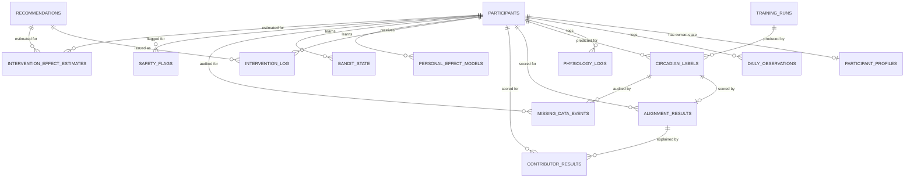

# CircadianIQ Final Database Design (Phase 18 release consolidation)

**Release:** v1.0.0-research-demo. **Status:** RELEASE READY WITH DOCUMENTED LIMITATIONS (Phase 17 audit verdict: CONDITIONAL PASS). **Schema version:** Alembic head `e5f9c27b4d8a`.

This document is the final, consolidated reference for the CircadianIQ
relational schema as frozen for release. It supersedes
[`docs/database_architecture.md`](database_architecture.md) (the
Phase 2 design document) as the authoritative description of the
*current* schema -- the design rationale in that document still holds
and is not repeated in full here, but several tables gained columns
in later phases (16 is denoted below), and one table
(`intervention_effect_estimates`) was added in Phase 12. Every table,
column, and constraint below was read directly from the live ORM
models under [`app/database/models/`](../app/database/models/), not
copied from the earlier document.

## 1. SQL's role: authoritative longitudinal state

CircadianIQ's relational database is not a cache and not a
convenience layer -- it is the **single source of truth for every
participant's longitudinal state**. The Python computational pipeline
(feature engineering, XGBoost, the state engine, fusion, alignment,
contributor ranking, recommendation selection, personalization,
safety) is stateless between calls: every run reads its inputs from
SQL and writes its outputs back to SQL, and nothing about a
participant's history, current state, or prior predictions is held in
Python-process memory across calls. Two consequences follow directly
from this:

- **Nothing bypasses SQL.** There is no secondary store, cache, or
  file-based state that the pipeline treats as authoritative. A
  participant's circadian history is exactly what is in
  `circadian_labels`/`alignment_results`/`contributor_results`, never
  an in-memory reconstruction.
- **Reproducibility depends on SQL being the sole state carrier.**
  Phase 17's reproducibility audit (two full pipeline runs off an
  identical DB snapshot) verified this holds end-to-end, including
  through the personalization/bandit subsystem, which was confirmed to
  require an explicit caller-supplied RNG specifically so persisted
  posterior state (not process memory) drives its behavior.

## 2. Complete table list (14 tables)

| # | Table | Nature | Purpose |
|---|-------|--------|---------|
| 1 | `participants` | Append-only identity | Identity/onboarding metadata |
| 2 | `participant_profiles` | **Mutable current state** | Stable biology + current computed state (1:1 with `participants`) |
| 3 | `daily_observations` | Append-only historical fact | Raw daily behavioral/environmental inputs (Version-1 ML input) |
| 4 | `physiology_logs` | Append-only historical fact | Raw daily physiological measurements (deliberately never used by Version-1 ML) |
| 5 | `circadian_labels` | **Immutable history** (one mutable pointer field, `is_latest`) | Per-prediction-event circadian phase output |
| 6 | `alignment_results` | Immutable history | Alignment score + component breakdown, 1:1 with a `circadian_labels` row |
| 7 | `contributor_results` | Immutable history | Ranked top-N contributor signals per alignment result |
| 8 | `recommendations` | Reference/catalogue | Candidate intervention catalogue |
| 9 | `intervention_log` | Append-only historical fact | One issued intervention + its outcome, per participant/date |
| 10 | `personal_effect_models` | **Mutable current state** | Learned per-participant/intervention-type linear effect model |
| 11 | `bandit_state` | **Mutable current state** | Learned per-participant/intervention-type contextual-bandit posterior |
| 12 | `missing_data_events` | Append-only historical fact | Missing-data / imputation audit trail |
| 13 | `safety_flags` | Hybrid (creation append-only, resolution mutates 2 fields) | Safety flag events |
| 14 | `training_runs` | Append-only historical fact | Model training run metadata |
| 15 | `intervention_effect_estimates` | Immutable history | Versioned, recomputable intervention-effect estimates (added Phase 12) |

(15 tables total; numbered to 15 above because `intervention_effect_estimates` was introduced after the original Phase 2 count of 14.)

## 3. Entity-relationship diagram

## 4. Table-by-table reference (current schema, as of `e5f9c27b4d8a`)

Types below are the SQLAlchemy generic types actually declared in the
models; §8 covers SQLite/PostgreSQL portability.

### 4.1 `participants`

| Column | Type | Constraints |
|---|---|---|
| `id` | Integer | **PK** |
| `participant_code` | String(50) | **UNIQUE**, indexed, NOT NULL |
| `enrollment_date` | Date | NOT NULL |
| `status` | String(30) | NOT NULL, default `"active"` |
| `onboarding_completed_at` | Date | nullable |
| `created_at` / `updated_at` | DateTime(tz) | NOT NULL |

### 4.2 `participant_profiles` (1:1 with `participants`, mutable current state)

| Column | Type | Notes |
|---|---|---|
| `participant_id` | Integer | **PK**, **FK -> participants.id** (`CASCADE`) |
| `chronotype_category` | String(50) | nullable -- intrinsic category, never derived from `current_dlmo_time` |
| `intrinsic_dlmo_time` | Time | nullable -- stable biological predisposition |
| `adapted_dlmo_time` | Time | nullable -- slowly-changing behavioral equilibrium |
| `current_dlmo_time` / `current_dlmo_date` | Time / Date | nullable -- latest dynamic daily estimate |
| `meq_score` / `meq_category` | Float / String(50) | nullable |
| `msfsc_time` | Time | nullable |
| `current_alignment_score` / `current_alignment_date` | Float / Date | nullable -- current-state cache |
| `synthetic_personality_profile` | JSON | nullable -- Phase 3 synthetic-generation input |
| `created_at` / `updated_at` | DateTime(tz) | NOT NULL |

Only `participant_profiles` is a genuinely mutable "current state"
row per participant; every field on it is updated in place as the
daily inference pipeline recomputes (§7).

### 4.3 `daily_observations` (append-only, one row per participant/date)

Sleep, light, screen, meal, exercise, and caffeine fields at
`(participant_id, observation_date)` grain: `sleep_onset_time`,
`sleep_offset_time`, `sleep_duration_minutes`, `sleep_midpoint_time`,
`sleep_midpoint_variability_minutes`, `is_free_day`,
`free_day_sleep_onset_time`, `free_day_sleep_offset_time`,
`free_day_sleep_midpoint_time`, `social_jetlag_minutes`,
`free_day_ratio`, `msfsc_time`, `morning_light_start_time`,
`morning_light_duration_minutes`, `evening_screen_end_time`,
`evening_screen_duration_minutes`, `last_meal_time`,
`meal_to_sleep_gap_minutes`, `exercise_time`,
`exercise_duration_minutes`, `last_caffeine_time`,
`caffeine_amount_mg`, plus `id`, `participant_id` (FK, `CASCADE`),
`observation_date`, `created_at`.

**Constraint:** `UNIQUE(participant_id, observation_date)`
(`uq_daily_obs_participant_date`). **Index:**
`(participant_id, observation_date)`.

### 4.4 `physiology_logs` (append-only, structurally separate from Version-1 inputs)

`id`, `participant_id` (FK, `CASCADE`), `observation_date`,
`resting_heart_rate_bpm`, `hrv_ms`, `wrist_temperature_c`,
`created_at`. **Constraint:** `UNIQUE(participant_id,
observation_date)`. Kept in a physically separate table (not merely a
"do not use these columns" convention on `daily_observations`) so it
is structurally impossible for Version-1 feature engineering to
"accidentally" read a physiological signal -- verified directly by
Phase 17's feature-contract audit.

### 4.5 `circadian_labels` (immutable per-prediction-event history)

| Column | Type | Notes |
|---|---|---|
| `id` | Integer | **PK** |
| `participant_id` | Integer | **FK -> participants.id** (`CASCADE`), NOT NULL |
| `target_date` | Date | NOT NULL |
| `computed_at` | DateTime(tz) | NOT NULL, server default now |
| `is_latest` | Boolean | NOT NULL, default `True` -- **the one mutable pointer field** |
| `prediction_status` | String(30) | NOT NULL |
| `xgboost_dlmo_sin` / `xgboost_dlmo_cos` / `xgboost_dlmo_time` | Float / Float / Time | nullable -- raw + decoded XGBoost output |
| `state_model_dlmo_time` | Time | nullable |
| `fused_dlmo_sin` / `fused_dlmo_cos` / `fused_dlmo_time` | Float / Float / Time | nullable -- raw + decoded, user-facing DLMO |
| `disagreement_minutes` / `disagreement_regime` | Float / String(30) | nullable |
| `confidence_score` / `confidence_label` | Float / String(30) | nullable |
| `data_completeness` | Float | nullable |
| `missing_features` / `imputed_features` | JSON | nullable -- feature-name lists |
| `training_run_id` | Integer | **FK -> training_runs.id** (`SET NULL`), nullable |
| `safe_output_status` / `recommendation_suppressed` / `safety_severity` | String(30) / Boolean / String(20) | nullable -- added Phase 14 (migration `c3f7a08e21b4`); the safety layer's own decision, stored for joinless reads, never used to derive or mutate any prediction field |

**Indexes:** `(participant_id, target_date)`,
`(participant_id, is_latest)`.

**Longitudinal pattern:** one row per (participant, date, *event*),
with no uniqueness constraint on `target_date` -- predictions can be
re-run, and each run inserts a new row rather than overwriting the
last. `is_latest` identifies the currently-authoritative row for a
date. **This is exactly the shape of known limitation #1** (§9).

### 4.6 `alignment_results` (immutable, 1:1 with a `circadian_labels` row)

| Column | Type | Notes |
|---|---|---|
| `id` | Integer | **PK** |
| `circadian_label_id` | Integer | **FK -> circadian_labels.id** (`CASCADE`), **UNIQUE**, NOT NULL |
| `participant_id` / `target_date` | Integer / Date | denormalized (FK `CASCADE`), NOT NULL -- see §6 |
| `final_alignment_score` | Float | NOT NULL |
| `phase_alignment_score` | Float | NOT NULL (60% weight, applied in Python) |
| `behavioral_alignment_score` | Float | NOT NULL (40% weight, applied in Python) |
| `sleep_consistency_score` / `morning_light_score` / `evening_screen_score` / `meal_timing_score` / `social_jetlag_score` | Float | nullable, individually queryable sub-scores |
| `ideal_sleep_onset_time` / `actual_sleep_onset_time` | Time | nullable -- added Phase 16 (migration `e5f9c27b4d8a`), for UI clock visualization; not recomputed at read time |
| `component_snapshot` | JSON | nullable -- explanatory detail beyond the named columns; also carries the full pipeline `provenance` dict (§8) |
| `computed_at` | DateTime(tz) | NOT NULL |

**Index:** `(participant_id, target_date)`.

### 4.7 `contributor_results` (immutable, many per `alignment_results` row)

`id`, `alignment_result_id` (FK `CASCADE`), `participant_id` /
`target_date` (denormalized), `rank`, `contributor_signal`,
`effect_estimate`, `alignment_deficit`, `direction`,
`anomaly_status`, plus `contributor_score` / `today_anomaly` (added
Phase 15, migration `d4e8b19f3a2c`, for a complete read-only API
response without recomputation). **Constraint:**
`UNIQUE(alignment_result_id, rank)`. **Index:**
`(participant_id, target_date)`.

### 4.8 `recommendations` (catalogue, mutable reference data)

`id`, `intervention_code` (**UNIQUE**, indexed), `intervention_type`
(indexed), `title`, `description`, `target_behavior`,
`literature_expected_improvement_minutes` (nullable -- intentionally
never populated with an invented number), `source`, `is_active`
(default `True`), `feasibility_notes`, `extra_metadata` (JSON),
`created_at` / `updated_at`.

### 4.9 `intervention_log` (append-only outcome history)

`id`, `participant_id` (FK `CASCADE`), `recommendation_id` (FK
`RESTRICT` -- a catalogue row cannot be deleted while history
references it), `log_date`, `recommendation_text`,
`target_value_time` / `target_value_numeric`, `actual_value_time` /
`actual_value_numeric`, `expected_improvement_minutes`,
`personalization_phase`, `compliance_binary`, `compliance_degree`,
`dlmo_before_time` / `dlmo_after_time` / `dlmo_change_minutes`,
`alignment_before` / `alignment_after` / `alignment_change`,
`measurement_phase`, `effect_estimate`, `confound_flag` (NOT NULL,
default `False`), `created_at`. **Index:**
`(participant_id, log_date)`.

### 4.10 `personal_effect_models` (mutable current state, one row per participant/intervention type)

`id`, `participant_id` (FK `CASCADE`), `intervention_type`, `slope`,
`intercept`, `r_squared`, `num_observations` (default 0),
`personalization_phase`, `confidence_interval_lower` /
`confidence_interval_upper` / `model_version` / `evidence_source`
(added Phase 13, migration `bd2e1f4a9c31` -- validity/explainability
metadata; this row's own historical evolution is *not* versioned
here, that lives in `intervention_effect_estimates`), `last_updated`.
**Constraint:** `UNIQUE(participant_id, intervention_type)`.

### 4.11 `bandit_state` (mutable current state, one row per participant/intervention type)

`id`, `participant_id` (FK `CASCADE`), `intervention_type`,
`posterior_mean`, `posterior_variance`, `total_pulls` (default 0),
`total_reward` (default 0.0), `last_updated`. **Constraint:**
`UNIQUE(participant_id, intervention_type)`.

### 4.12 `missing_data_events` (append-only audit trail)

`id`, `participant_id` (FK `CASCADE`), `circadian_label_id` (FK `SET
NULL`, nullable), `observation_date`, `signal_name`, `signal_tier`
(free-text, not an enforced vocabulary), `is_missing`, `is_imputed`
(default `False`), `imputation_source`, `confidence_penalty`,
`recorded_at`. **Index:** `(participant_id, observation_date)`.

### 4.13 `safety_flags` (append-only creation, two mutable resolution fields)

`id`, `participant_id` (FK `CASCADE`), `flagged_date`, `flag_type`,
`severity`, `message_shown`, `recommendation_suppressed` (default
`False`), `resolved_date` / `resolved_by` (**the only fields mutated,
when a flag is resolved**), `message_key`, `first_detected_date`,
`last_observed_date`, `triggering_statistics` (JSON),
`detection_version` -- the last five added Phase 14 (migration
`c3f7a08e21b4`); of these, only `last_observed_date` is ever mutated
after creation alongside `resolved_date`/`resolved_by` --
`first_detected_date`, `triggering_statistics`, and
`detection_version` are a permanent record of what first triggered
the flag. `created_at`. **Index:** `(participant_id, flagged_date)`.

### 4.14 `training_runs` (append-only)

`id`, `model_type`, `model_version`, `num_participants`,
`num_windows`, `feature_count`, `cv_metrics` (JSON),
`trained_at`, `artifact_path`, `artifact_version`, `notes`,
`created_at`. **Constraint:** `UNIQUE(model_type, model_version)`.

### 4.15 `intervention_effect_estimates` (added Phase 12, immutable versioned history)

Distinct from `intervention_log`'s per-day facts: this table stores
the **derived, evolving estimate** computed from those facts, kept
separate because an estimate has its own lifecycle (recomputed as
history accumulates) and old estimates must remain auditable rather
than overwritten.

`id`, `participant_id` (FK `CASCADE`), `recommendation_id` (FK
`CASCADE`), `measurement_phase` (Integer: 1 observational / 2
matched-observational / 3 regression-controlled), `interpretation`,
`period_start` / `period_end` (Date, nullable), `effect_estimate`
(Float, minutes, signed -- advance negative), `confidence_interval_lower`
/ `confidence_interval_upper`, `standard_error`, `r_squared`,
`n_observations`, `compliance_rate`, `confound_flag` (default
`False`), `methodology_version`, `model_version`, `diagnostics`
(JSON), `created_at`. **Index:**
`(participant_id, recommendation_id)`. A recomputation (more history,
a new methodology version) inserts a new row; it never overwrites the
previous estimate.

## 5. Relationships summary

- `participants` -> `participant_profiles` (1:1, shared PK/FK).
- `participants` -> every longitudinal/per-participant table (1:N,
  direct `participant_id` FK): `daily_observations`,
  `physiology_logs`, `circadian_labels`, `alignment_results`,
  `contributor_results`, `intervention_log`, `personal_effect_models`,
  `bandit_state`, `missing_data_events`, `safety_flags`,
  `intervention_effect_estimates`.
- `circadian_labels` -> `alignment_results` (1:1 via a unique FK).
- `alignment_results` -> `contributor_results` (1:N).
- `recommendations` -> `intervention_log` (1:N, `RESTRICT`).
- `recommendations` -> `intervention_effect_estimates` (1:N, `CASCADE`).
- `training_runs` -> `circadian_labels` (1:N, `SET NULL`, optional
  traceability).
- `circadian_labels` -> `missing_data_events` (1:N, `SET NULL`,
  optional link to the run an audit event informed).

## 6. Normalization rationale

- **Identity vs. current state vs. history** are kept as three
  separate concerns: `participants` (identity), `participant_profiles`
  (current/mutable state), and per-event tables like `circadian_labels`
  (immutable history) -- this avoids one row mixing update frequencies.
- **`daily_observations` is one wide table**, not six near-duplicate
  ones: every sleep/light/screen/meal/exercise/caffeine column depends
  only on `(participant_id, observation_date)`, so splitting would add
  five extra 1:1 joins without removing any redundancy.
  `physiology_logs` is the one deliberate structural exception, split
  out not for normalization but to make it structurally undeniable
  that Version-1 code cannot read physiological data.
- **`circadian_labels` / `alignment_results` / `contributor_results`
  are split** despite being computed together, because they have
  different cardinalities (1 prediction : 1 alignment score : N
  contributors) and are queried independently.
- **Denormalized `participant_id`/`target_date`** on
  `alignment_results` and `contributor_results`: derivable via a join
  back through `circadian_labels`, but copied onto child rows so
  "this participant's alignment/contributor history" needs no join.
  This is a documented denormalization for query convenience, never a
  duplication of true participant information.
- **JSON used sparingly**, only where the internal structure is
  genuinely variable and does not need relational filtering:
  `missing_features`/`imputed_features`, `component_snapshot`,
  `cv_metrics`, `synthetic_personality_profile`,
  `triggering_statistics`, `extra_metadata`, `diagnostics`. Every
  field that needs direct SQL filtering (scores, ranks, dates, flags)
  is a real column.

## 7. Immutable vs. mutable data

| Table | Nature | Mutable field(s) |
|---|---|---|
| `participants` | mostly append-only | `status`, `onboarding_completed_at` |
| `participant_profiles` | **mutable current state** | all fields |
| `daily_observations` | append-only historical fact | none by policy |
| `physiology_logs` | append-only historical fact | none by policy |
| `circadian_labels` | **immutable history** | only `is_latest` |
| `alignment_results` | immutable history | none |
| `contributor_results` | immutable history | none |
| `recommendations` | reference/catalogue | `is_active`, description text as the catalogue evolves |
| `intervention_log` | append-only historical fact | none |
| `personal_effect_models` | **mutable current state** | all fields, upserted per participant/type |
| `bandit_state` | **mutable current state** | all fields, upserted per participant/type |
| `missing_data_events` | append-only historical fact | none |
| `safety_flags` | hybrid | `resolved_date`, `resolved_by`, `last_observed_date` |
| `training_runs` | append-only historical fact | none |
| `intervention_effect_estimates` | immutable history | none -- a recomputation inserts a new row |

"By policy" means the schema itself does not add a database trigger
preventing updates to raw historical tables -- that discipline belongs
to the application layer. What must never happen, and what the
`is_latest` pattern exists to prevent, is silently overwriting a
prediction, alignment score, or intervention outcome that has already
been produced and potentially acted upon.

## 8. Transaction boundaries: the daily-inference write

The daily inference pipeline (`app.pipeline.orchestrator.run_daily_inference`,
[`docs/daily_inference_pipeline.md`](daily_inference_pipeline.md))
follows a strict `READ everything -> COMPUTE everything -> BEGIN one
atomic write transaction -> COMMIT` structure -- no expensive
computation ever happens while a write transaction is open. The single
write transaction, opened via `app.database.engine.session_scope`,
performs, in order:

1. `supersede_existing_label` -- flip the previous `is_latest=True`
   `circadian_labels` row (if any) to `False`.
2. Insert the new `circadian_labels` row.
3. Insert its `alignment_results` row and `contributor_results` rows.
4. Supersede/insert the `intervention_log` row.
5. Update `participant_profiles`' current-state columns
   (`current_dlmo_time`/`current_dlmo_date`, `adapted_dlmo_time`,
   `current_alignment_score`/`current_alignment_date`).

Any exception anywhere in that block rolls back **all** of it -- Phase
17's failure-injection audit forced a failure during recommendation
persistence and confirmed zero pipeline-authored `circadian_labels`
rows and an untouched `participant_profiles` row resulted. A separate
audit test forced two naive double-calls and a forced double
`force_rerun` and confirmed no more than one `is_latest=True` row ever
results from this application-level discipline (§9, limitation #1,
covers the residual gap this discipline does not close at the DB
level).

Version/provenance for a run is carried in a
`diagnostics["provenance"]` dict (`pipeline_version`,
`feature_manifest_version`, `model_version`, `state_config_version`,
`fusion_config_version`, `alignment_config_version`,
`contributor_config_version`, `recommendation_config_version`); what
the schema itself supports is persisted directly
(`circadian_labels.training_run_id`, and the full `provenance` dict
inside `alignment_results.component_snapshot`) -- see limitation #2
below for what is *not* persisted as a structured column.

Personalization (`app.personalization.update_personalization_state`)
and intervention effectiveness run as a separate, explicitly
`as_of_date`-scoped offline pipeline that daily inference only ever
*reads* from, never triggers -- it has its own read/write boundaries
and is not part of the daily-inference atomic transaction above.

## 9. Known limitations (carried from Phase 17, release-relevant to the schema)

These three limitations are preserved verbatim in substance from the
Phase 17 audit (`docs/system_validation_and_audit.md` §§4, 22, 16, 30)
and the release version manifest
(`release/version_manifest.json`); none of them caused an observed
incorrect output in that audit, and none blocks release, but all three
are schema-shaped and belong in this document:

1. **No DB-level uniqueness constraint on `circadian_labels.is_latest`.**
   The invariant "at most one `is_latest=True` row per
   `(participant_id, target_date)`" is enforced only by application
   discipline (`supersede_existing_label` always flips existing rows
   first) combined with SQLite's single-writer serialization. A
   concurrent write path on a multi-writer backend (e.g. PostgreSQL
   under real concurrency) could violate it. No CHECK constraint or
   partial-unique-index exists for this. Recommended follow-up (not
   performed in this release, since it is a schema decision): a
   partial unique index `WHERE is_latest = true` on
   `(participant_id, target_date)`.

2. **Structured version-provenance columns are incomplete.** Only the
   XGBoost model version is a queryable column
   (`circadian_labels.training_run_id -> training_runs.model_version`).
   Pipeline/fusion/state/alignment/recommendation config versions
   exist only inside `alignment_results.component_snapshot`'s JSON
   blob (opaque, unindexed) -- and `contributor_results` /
   `intervention_log` carry no version information of any kind, not
   even inside a JSON blob. Full structured provenance would require
   adding version columns across three-plus tables, which is a
   deliberate schema-design decision beyond this release's scope.

3. **`app.personalization.db_adapter.latest_recommendation_id_for_type`
   is not `as_of_date`-scoped.** This is a catalogue-versioning gap --
   **not** a participant-data leak. If the `recommendations` catalogue
   were ever edited mid-study (a row deactivated/replaced after a
   given `as_of_date`), a replay of "what would have been decided on
   day t" could pick a different `recommendation_id` than what was
   actually active on day t. Participant behavioral/outcome data
   itself is correctly `as_of_date`-scoped everywhere else, verified
   by an explicit temporal-replay proof in Phase 17
   (`tests/audit/test_audit_13_personalization_leakage.py`). Recommended
   follow-up: an `effective_date`/`superseded_date` pair on
   `Recommendation` if the catalogue is ever made editable during a
   live study.

## 10. SQLite / PostgreSQL portability

No engine-specific SQL appears anywhere in the models; every column
uses a SQLAlchemy generic type. `Time` columns round-trip
`datetime.time` transparently on both engines. JSON columns use
`PortableJSON` (`app/database/models/base.py`) -- plain `JSON` on
SQLite, native `JSONB` on PostgreSQL. `create_app_engine()` issues
`PRAGMA foreign_keys=ON` on every SQLite connection so
`CASCADE`/`RESTRICT`/`SET NULL` behave identically to PostgreSQL
(without this, constraint enforcement would silently no-op on
SQLite). No native `ENUM` types are used for open-ended categorical
fields (`prediction_status`, `disagreement_regime`, `flag_type`,
`personalization_phase`, `measurement_phase`, etc.) -- plain `String`
columns instead, so a new category value never requires a migration
on either engine. The demo/release database engine is SQLite (see
[`docs/dbms_demo_queries.sql`](dbms_demo_queries.sql)); nothing about
the schema prevents pointing the same code at PostgreSQL by changing
only the `database_url` environment configuration.

## 11. Migrations

Alembic (`migrations/`) is the schema source of truth; the schema
described in this document corresponds to Alembic head revision
`e5f9c27b4d8a` (the Phase 16 revision that, among other things, added
`alignment_results.ideal_sleep_onset_time` /
`actual_sleep_onset_time`). `scripts/init_db.py` runs `alembic upgrade
head` and then seeds the `recommendations` catalogue -- it is the only
code path that creates schema in a real deployment;
`app.database.init_db.create_all_tables()` remains a lower-level
convenience used only by the test suite's throwaway databases.

## 12. Seed data

`app/database/seed.py` seeds only the static `recommendations`
catalogue (six intervention entries: morning light, evening screen
reduction, consistent sleep schedule, earlier last meal, exercise
timing, reduced late caffeine). No
`literature_expected_improvement_minutes` value is populated for any
entry, per the project's rule against inventing scientific constants.
Seeding is idempotent.

## 13. Testing (as of the Phase 17 audit)

1006/1007 backend tests pass (1 skipped, explicitly gated opt-in),
0 failed; 60/60 frontend tests pass; a clean production build. This
includes 9 dedicated database-integrity audit tests
(`tests/audit/test_audit_db_integrity.py`) verifying Alembic
reproducibility across independent fresh databases, cascade-delete
correctness across every FK-owned table, full transactional rollback
on a forced failure at the final write step, and the "no more than one
`is_latest=True` row" invariant under simulated race conditions
(alongside the original Phase 2 schema/constraint/longitudinal test
modules, `tests/test_db_schema.py`, `tests/test_db_constraints.py`,
`tests/test_db_longitudinal.py`).
